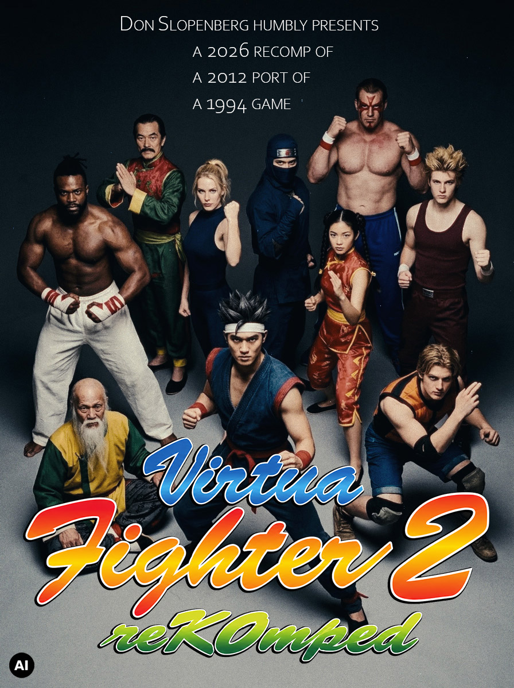

<p align="center"></p>

<p align="center"><b>2012 Xbox360 Live Arcade Edition, recompiled for Windows</b></p>

<p align="center">[](https://playported.com/ports/640-virtua-fighter-2/)

<div align="justify">

Virtua Fighter 2 reKOmped started as a little experiment, a proof of concept to see whether someone with absolutely no programming experience could build something like this. And apparently, the answer is maybe?

</div>

<div align="justify">

On Windows platform the game runs really well, even better than the MAME edition. Much of the credit goes to the developers behind the excellent 2012 Xbox 360 port. This project simply adds another brick to what they built.

</div>

<div align="justify">

Thanks to advances in AI, we now have proper widescreen support and improved versions of the original backgrounds, whose age is particularly obvious on today's unforgiving LCD screens compared to the CRTs they were designed for.

</div>

<div align="justify">

Interestingly, the port still contains Xbox networking code, which someone with more experience might eventually turn into working multiplayer. The game has been tested a lot and runs reliably.

</div>

<div align="justify">

It's incredibly satisfying to see something grow out of little more than an idea. It also gave me an excuse to revisit a childhood favourite I played on the Saturn, in arcades and later on PC. More than 30 years later, Virtua Fighter 2 still looks surprisingly good, retains its unique visual style, and is a pleasure to play in 4K on modern hardware.

</div>

<div align="justify">

One fun fact: I suspect about 60% of the entire AI computing effort went into fixing the background scrolling and those damned interlaced waves in Dural's arena. After dozens of iterations, everything finally works. Although I'm fully expecting someone with a non-NVIDIA GPU to prove me wrong ;)

</div>

<div align="justify">

Everyone is welcome to jump in, fix things and take the project further.

</div>

<div align="justify">

**Virtua Fighter 2 reKOmped** is a native Windows port of the 2012 Xbox 360 Live Arcade release of Virtua Fighter 2, built with the ReXGlue static recompilation SDK. The arcade game itself still runs through the original emulated Model 2 code, so the gameplay is untouched. The port adds high resolutions, ultrawide support, a launcher, an in-game settings menu, a Custom Fight launcher and a few Arcade options.

</div>

> **No game files are included.** You need your own copy of the Xbox 360 XBLA package of Virtua Fighter 2. The installer extracts and verifies it locally.

### Accepted game package

<div align="justify">

The installer accepts exactly one package: the Xbox 360 Live Arcade release of Virtua Fighter 2 (title ID `5841129C`).

</div>

| | |
| --- | --- |
| Package file | `65D8FAC10B21FA185AAB93607663594CB568C78658` |
| Location on an Xbox 360 drive | `Content\0000000000000000\5841129C\000D0000\` |
| Size | 66,928,640 bytes |
| SHA-256 | `2e4700ca9bc3ea747379a1d3648b59bcdff6c528d1aefe241a51b47757c74099` |

<div align="justify">

Supply either this file directly or a RAR archive that contains it once, in any folder (for example `Virtua Fighter 2.rar`). The RAR itself is not hash-checked, only the package inside it. The installer also verifies the package's internal SHA-1 hash tree and the SHA-256 of every extracted game file, and rejects any other revision.

</div>

## Features

- **Resolutions**: 1280x720, 1920x1080, 2560x1440, 3840x2160 and the 21:9 ultrawide 2560x1080 / 3440x1440. The 3D scene and the arena backgrounds fill the whole width; menus and HUD stay centred. Fullscreen or windowed, on any monitor.
- **Any refresh rate**: the game simulation stays at its native 60 Hz.
- **Wide arena backgrounds**: the complete original panoramas are drawn across the extended view, with optional upscaled backgrounds.
- **Faster start**: optional skip of the startup logos, automatic Push Start, and the first-start "No Save Data found" question answered automatically.
- **Arcade options**: Tourist difficulty, random opponents, random arenas, hidden Dural (hold Start for 3 s at character select), cheats.
- **Alternate costumes**: press Up/Down at character select (Arcade and Versus). The cursor frame turns to its negative colour while the alternate costume is chosen.
- **Custom Fight launcher**: any two of the eleven characters, Human or CPU on each side, alternate costumes, any arena, difficulty (including Tourist), rounds and round time.
- **Controllers and keyboard**: Xbox controllers through XInput, two players on one keyboard, keyboard/controller navigation in all menus.
- Local achievements ported from the Xbox360 Live Arcade version.

## Launcher

<div align="justify">

Start **Virtua Fighter 2.exe**. Settings are saved immediately to `data/engine/vf2.toml` and shared with the game.

</div>

| Option | Effect |
| --- | --- |
| Monitor | Screen the game opens on (shown with two or more monitors) |
| Resolution | Output resolution, 16:9 or 21:9 |
| Fullscreen | Fullscreen or windowed (F4 switches in game) |
| Skip Startup Logos | Leaves out the startup branding |
| Upscaled 2D Backgrounds | Uses the upscaled arena panoramas |
| Tourist | Below Easy: every CPU opponent stays at a constant, gentle level |
| Random Opponents | New opponent order every Arcade run, Dural always last |
| Random Arenas | Arenas are no longer tied to opponents: every stage gets a random one, no repeats |

<div align="justify">

Random options are not used in Ranking Mode. They do not affect achievements.

</div>

<div align="justify">

The launcher is optional: `data/engine/vf2.exe` can be started directly and uses the same settings, saves and log (`data/logs/game.log`).

</div>

## In game

| Key | Action |
| --- | --- |
| F4 | Fullscreen / windowed |
| F6 | Settings and Custom Fight Launcher (pauses the game) |
| F7 | Achievements |
| Esc | Pause the match (Arcade, Versus, Custom Fight) |

**F6 Settings**

- *VF2 reKOmped* / *Display*: resolution, background FOV, horizon height, background blur and smoothing, upscaled backgrounds.
- *Arcade & Cheats*: Random Opponents, Random Arenas, Tourist difficulty, hidden Dural, Infinite Health P1/P2. Using a cheat disables achievements until the game restarts.
- *Custom Fight Launcher...*: characters (including Dural), Human/CPU, alternate costume per player, arena (including the native variants), difficulty (Game Settings, Tourist, Easy, Normal, Hard, Hardest), rounds to win and round time; **Start Fight** and **Restart Fight**. A fight started during an Arcade or Versus game leaves that game first; a finished match returns to the Main Menu.

**Keyboard**

| | Player 1 | Player 2 |
| --- | --- | --- |
| Move | W A S D | Arrow keys |
| Guard | V | Delete |
| Punch | B | End |
| Kick | C | Page Down |
| Start | Z | Enter |

## Install

1. Download the release ZIP and extract it into a writable folder.
2. Put your `Virtua Fighter 2.rar` or the package file `65D8FAC10B21FA185AAB93607663594CB568C78658` next to `INSTALL.cmd` (or drop it onto `INSTALL.cmd`) and run `INSTALL.cmd`.
3. Start `Virtua Fighter 2\Virtua Fighter 2.exe`.

<div align="justify">

The installer checks the package's hash tree and every original file, and stops with a clear message if the package is missing, damaged or a different revision. Reinstalling keeps saves (`data/userdata`) and settings (`data/engine/vf2.toml`).

</div>

<div align="justify">

Requirements: Windows 10 1803 or newer (x64) and a Direct3D 12 GPU.

</div>

## Building from source

<div align="justify">

Requirements: Visual Studio 2022 Build Tools (C++), LLVM/clang, CMake and Ninja, the ReXGlue SDK 0.10.0 unpacked to `tools/rexglue-sdk-0.10.0/win-amd64`, Python 3, and your own extracted game files in `data/game/`.

</div>

```
cd native
..\tools\rexglue-sdk-0.10.0\win-amd64\bin\rexglue.exe codegen vf2_manifest.toml
build.cmd
```

<div align="justify">

`codegen` recompiles `data/game/default.xex` into `native/generated/default` (not part of this repository). `build_release.cmd` builds the release preset, and `python tools/package_release.py` creates the installer package in `dist/`. `tools/prepare_launcher_art.py` rebuilds the launcher logo and icon from `native/resources/logo_master.png`.

</div>

## Repository layout

| Path | Contents |
| --- | --- |
| `native/src/` | Port sources: launcher, display, settings, Custom Fight, Arcade options |
| `native/resources/` | Logo, icon, version resources |
| `installer/` | `INSTALL.cmd` and the PowerShell installer |
| `tools/` | Packaging, asset export, art and test scripts |
| `analysis/` | Investigation notes and verification reports |

## Credits

<div align="justify">

Created by Sol, Opus and Don Slopenberg. Virtua Fighter 2 and its original logo are trademarks of SEGA; this project is not affiliated with or endorsed by SEGA. Runtime: ReXGlue (Xenia-derived); see the SDK licenses shipped with the release.

</div>

<div align="justify">

See [CHANGELOG.md](CHANGELOG.md) for the version history.

</div>
